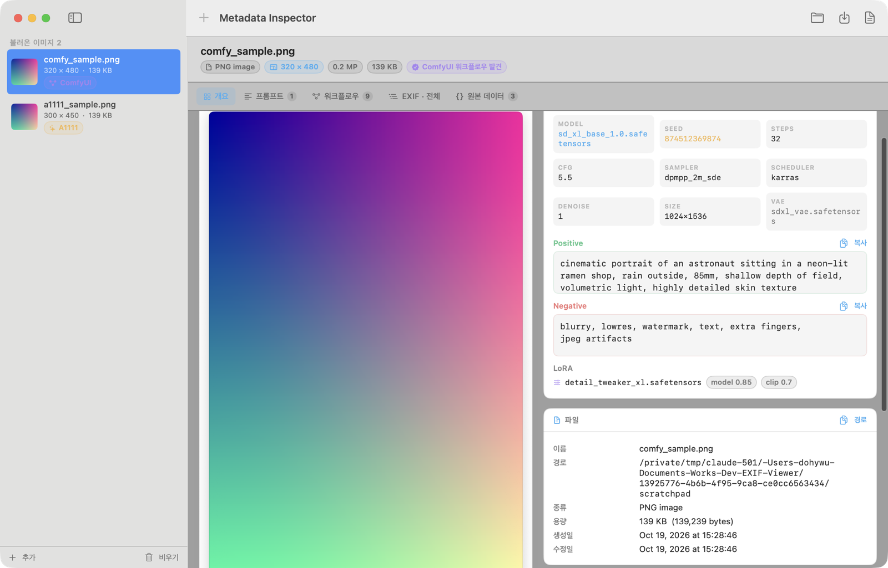

<p align="center">
  
</p>

<h1 align="center">Metadata Inspector</h1>

<p align="center">
  A native macOS app that shows <b>every</b> piece of metadata an image carries.<br>
  Drop a <b>ComfyUI</b> image on it and the prompts and the whole workflow come back.
</p>

<p align="center">
  
  
  
  
</p>

<p align="center">
  
</p>

## What it reads

| Source | Details |
| --- | --- |
| ImageIO | EXIF, TIFF, IPTC, GPS, JFIF, PNG, HEIC/WebP container properties, color profile |
| XMP | Full tag tree, nested structures included |
| PNG chunks | Raw walk of every chunk: `tEXt`, `zTXt` (zlib-inflated), `iTXt`, plus type, size and offset |
| ComfyUI | `prompt` (API graph) and `workflow` (GUI graph) JSON, from PNG text chunks or EXIF tags |
| A1111 / Forge | `parameters` block → positive, negative, steps, sampler, CFG, seed, size, model hash … |
| InvokeAI · Midjourney | Embedded JSON and text payloads shown as they are |

## ComfyUI analysis

The graph is reconstructed and walked, not just dumped.

- **Prompts** — the sampler's `positive` / `negative` links are followed backwards to the text that actually fed it, through however many conditioning nodes sit in between.
- **Checkpoint** — resolved through LoRA loaders and model patchers, so a LoRA file name is never mistaken for the checkpoint.
- **Sampling values** — seed, steps, CFG, sampler, scheduler, denoise, latent size, including custom-sampler graphs where those live on `*SchedulerNode`, `SamplerSelect` or `RandomNoise`.
- **LoRAs** — all of them, with model/clip strengths, plus the VAE loader.
- Each sampling pass in the graph gets its own card.
- **Node browser** — searchable and expandable; every input shows either its literal value or the node it is linked from. Export the workflow JSON to load it back into ComfyUI.

## Tabs

1. **Overview** — preview, generation summary, file and image facts, camera and GPS when present
2. **Prompt** — one card per sampling pass, copy button on every prompt
3. **Workflow** — node browser with search and JSON export
4. **EXIF · All** — searchable tree of every property, XMP tag and PNG chunk
5. **Raw** — the raw text payloads, pretty-printed when they are JSON

## Build

```bash
./build.sh            # dist/Metadata Inspector.app
./build.sh --install  # installs straight into /Applications
```

No dependencies — Swift 6, SwiftUI, ImageIO and Compression only. The output is an ad-hoc signed native app for macOS 14+.

## Shortcuts

| Key | Action |
| --- | --- |
| ⌘O | Open images or a folder |
| ⌘E | Export a full metadata report (.txt) |
| ⇧⌘S | Save the ComfyUI workflow JSON |
| ⌘R | Reveal in Finder |
| ⇧⌘⌫ | Clear the list |

Besides drag and drop, files can be opened from Finder ("Open With") or passed as command-line arguments. Drop a folder and every image inside it is read at once.

## Layout

```
Sources/EXIFViewer/
  App/      app entry, delegate (Finder/CLI file opening), view model
  Core/     PNG chunk reader, ImageIO extractor, ComfyUI graph parser, metadata tree
  UI/       theme, sidebar, detail shell, five tabs
tools/makeicon.swift   generates Resources/AppIcon.icns
build.sh               release build + .app bundling + ad-hoc signing
```

> The app's interface is currently in Korean.
